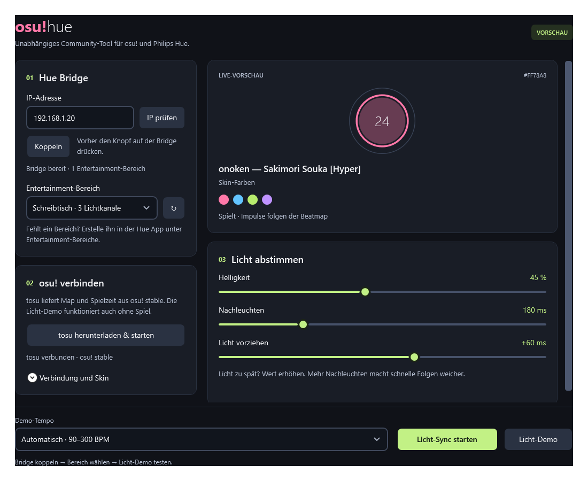

# osu!hue

A standalone Windows app that makes Philips Hue lights pulse in your osu! beatmap's combo colours.



## Try it

Download the Windows ZIP from [Releases](https://github.com/nyannoying1337/osu-hue/releases), extract it and run `OsuHue.exe`. The download includes .NET; your friend doesn't need to install a development SDK or build anything.

1. Enter the Hue Bridge's local IP address and check the connection.
2. Press the button on the Bridge, click **Koppeln**, then select an Entertainment area created in the Hue app.
3. Click **Licht-Demo** to try the lights. Pick a fixed tempo or cycle through 90, 120, 180, 240 and 300 BPM.
4. For gameplay, open osu! stable and run **normal released tosu**. The app can download and start the official release for you. Once the preview recognises your map, click **Licht-Sync starten**.

The interface is currently in German. **Demo beenden** and **Licht-Sync stoppen** stop the lights and restore their previous state. Normal app close does the same; network or power failures can prevent restoration.

### Does this need patched tosu?

**No.** The app works with released tosu through its existing beatmap-file endpoint. It also supports the proposed timeline endpoint in [tosu PR #726](https://github.com/tosuapp/tosu/pull/726), but falls back to the existing endpoint when that route returns 404.

| What you want to try | What you need |
| --- | --- |
| Screen-only demo | Just this app |
| Demo on real lights | This app, a Hue Bridge supporting Entertainment, compatible colour lights and an Entertainment area |
| Lights during gameplay | Everything above, osu! stable and normal released tosu |

The tosu contribution contains only a small generic data API. This repo contains the separate UI, Hue connection and effects.

## What it does

- Pulses at scheduled circle and slider-head times, including notes you miss.
- Uses beatmap or skin combo colours, with a manual skin override.
- Handles playback rate, pause, menus, map changes and stale data.
- Streams through Hue Entertainment at up to 50 updates per second.
- Keeps demo tempo and stop controls accessible in a resizable dark UI.

Brightness, fade duration and timing offset are adjustable. Every light channel in the selected area receives the same pulse; choose participating lights in the Hue app.

This follows hit objects rather than analysing audio. Spinner effects, slider ticks/repeats, precoloured skin textures and lazer/Argon-specific visuals aren't implemented. The supported target is Windows x64 and osu! stable / osu!standard. Very fast notes may blend together on physical lamps.

## Build and test

Requires Windows and the [.NET 10 SDK](https://dotnet.microsoft.com/download/dotnet/10.0).

```powershell
dotnet restore OsuHue.Tests/OsuHue.Tests.csproj --locked-mode
dotnet run --project OsuHue.Tests/OsuHue.Tests.csproj -c Release --no-restore
./scripts/Publish.ps1
```

The publish script produces a self-contained Windows x64 app in `artifacts/windows`, including dependency notices and the quick-start guide. GitHub Actions runs the regression suite and publishes a build artifact on pushes and pull requests.

The 103 automated checks use local HTTP/WebSocket fixtures and a simulated Hue transport. They don't operate your lights. Manual checks covered pairing reuse, map loading, keyboard controls, a real 300-BPM Entertainment demo and successful stop/restoration responses. Physical colour/timing hasn't been measured; lazer and Linux haven't been verified.

See [the architecture notes](docs-architecture.md) for parsing, timing, lifecycle and UI details.

## Local data and dependencies

Settings live in `%LOCALAPPDATA%\OsuHue\settings.json`. Bridge credentials are protected for the current Windows user with DPAPI; each person pairs their own Bridge. Settings and credentials are not included in downloads or this repository.

Gameplay data comes from loopback HTTP/WebSocket connections. Bridge control stays on the local network. Discovery and the optional official tosu download use internet access. There is no telemetry.

Third-party license texts are in [THIRD-PARTY-NOTICES](THIRD-PARTY-NOTICES). tosu is downloaded separately, not bundled in the Windows app.

## Project notes

This is an independent community tool, not an official osu! or Philips Hue product. The text heading and independent ring-and-dot icon are separate from the animated preview; no osu! cookie logo is recreated or modified. See the [osu! brand guidelines](https://osu.ppy.sh/wiki/en/Brand_identity_guidelines).

Development used substantial assistance from OpenAI Codex with GPT 6.1 Sol (`gpt-6.1-sol`).
